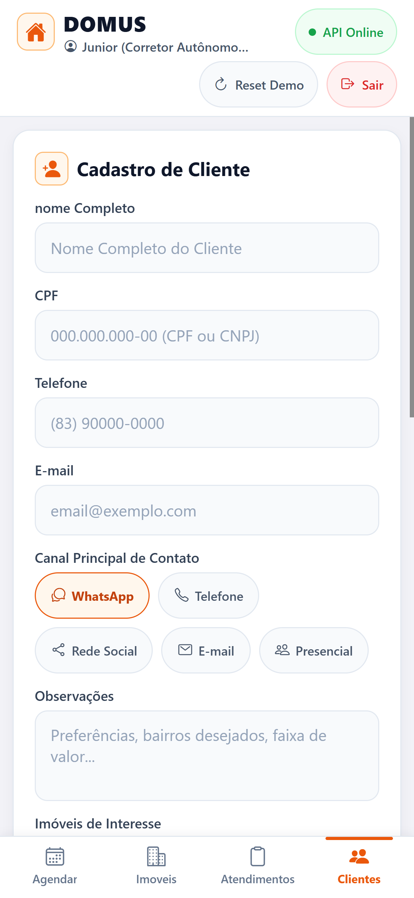

# DOMUS

Plataforma digital para organizacao e acompanhamento da rotina de corretores de imoveis, com foco em mobilidade, gestao de contatos, visitas e programacao de retornos comerciais.

<p align="left">
  <a href="https://reactnative.dev/"> <b>React Native</b></a> &nbsp;&bull;&nbsp;
  <a href="https://expo.dev/"> <b>Expo</b></a> &nbsp;&bull;&nbsp;
  <a href="https://www.typescriptlang.org/"> <b>TypeScript</b></a> &nbsp;&bull;&nbsp;
  <a href="https://nestjs.com/"> <b>NestJS</b></a> &nbsp;&bull;&nbsp;
  <a href="https://nodejs.org/"> <b>Node.js</b></a> &nbsp;&bull;&nbsp;
  <a href="https://www.prisma.io/"> <b>Prisma</b></a> &nbsp;&bull;&nbsp;
  <a href="https://www.sqlite.org/"> <b>SQLite</b></a> &nbsp;&bull;&nbsp;
  <a href="https://www.docker.com/"> <b>Docker</b></a> &nbsp;&bull;&nbsp;
  <a href="https://jestjs.io/"> <b>Jest</b></a> &nbsp;&bull;&nbsp;
  <a href="https://swagger.io/"> <b>Swagger</b></a>
</p>

> [!NOTE]
> **TL;DR:** Solucao fullstack ([NestJS 11](https://nestjs.com/) + [Expo SDK 58](https://expo.dev/) / [React Native](https://reactnative.dev/)) para organizacao de corretores de imoveis, centralizando clientes, imoveis, visitas e avisos de retornos comerciais. Execute o ecossistema completo na raiz com um unico comando: `npm run dev`.

---

## Sobre o Projeto

O DOMUS nasce da necessidade de superar as limitacoes de planilhas manuais na rotina de corretores autonomos. A partir de um estudo de caso com a Persona Junior (corretor atuante em Joao Pessoa - PB), identificou-se que o esquecimento de prazos e o atraso no retorno a clientes sao os principais fatores de desgaste no relacionamento comercial.

A proposta e fornecer uma ferramenta simples, direta e acessivel via dispositivo movel para centralizar o historico do cliente, os imoveis vinculados e o status de cada atendimento com avisos automaticos de compromissos proximos.

---

## Contexto Academico

- **Instituicao:** Centro Universitario UNIESP
- **Curso:** Sistemas para Internet (5o Periodo - 2026.2)
- **Unidade Curricular:** Programacao para Dispositivos Moveis e Projeto Extensionista IV (Empreendedorismo e Inovacao)
- **Professor Orientador:** Alekiss Manco de Melo
- **Equipe:**
  - Alexander Augusto de Figueiredo Baxendale
  - Pedro Neto Amancio
  - Rodrigo Santos Costa

---

## Principais Recursos

- **Gestao de Clientes:** Cadastro basico, canal principal de contato (WhatsApp, Telefone, Presencial) e vinculo com imoveis de interesse.
- **Catalogo de Imoveis:** Registro de caracteristicas fisicas (comodos, area, posicao solar) e comerciais (valores, venda e locacao).
- **Agendamento Inteligente:** Marcacao de visitas a imoveis, reunioes de atendimento e retornos obrigatorios, com validacao para evitar conflitos de horario na agenda do corretor.
- **Central de Avisos:** Alertas ativos para compromissos proximos da data marcada, retornos atrasados e pendencias sem data definida.
- **Integracao de Calendario:** Geracao de eventos compativeis com o [Google Calendar](https://calendar.google.com/).
- **Controle de Acesso:** Autenticacao segura via [JWT](https://jwt.io/) com perfis de Corretor e Cadastrador.

### Interface do Aplicativo Mobile (Prototipo Atual)

A tela de **Cadastro de Clientes** implementada em [React Native](https://reactnative.dev/) com [Expo SDK 58](https://expo.dev/) e integrada a API:

<p align="center">
  
</p>

---

## Arquitetura e Tecnologias

O sistema e estruturado em uma arquitetura desacoplada cliente-servidor:

- **Mobile (Frontend):** Desenvolvido em [ **React Native**](https://reactnative.dev/) com [ **Expo SDK 58**](https://expo.dev/) e [ **TypeScript**](https://www.typescriptlang.org/), priorizando uso em smartphones por corretores em deslocamento e suporte multiplataforma (Android, iOS e Web). Os padroes de arquitetura, ergonomia [Apple HIG](https://developer.apple.com/design/human-interface-guidelines/), fisica de gestos e persistencia offline-first estao detalhados em [docs/MOBILE_SYSTEM_DESIGN.md](docs/MOBILE_SYSTEM_DESIGN.md).
- **Backend (API):** Desenvolvido em [ **Node.js 22**](https://nodejs.org/) com [ **TypeScript**](https://www.typescriptlang.org/) e [ **NestJS 11**](https://nestjs.com/), seguindo principios de arquitetura modular, injecao de dependencias e validacao estrita por DTOs com [**class-validator**](https://github.com/typestack/class-validator). Detalhes em [backend/README.md](backend/README.md).
- **Banco de Dados e Persistencia:** [ **Prisma ORM**](https://www.prisma.io/) com [ **SQLite**](https://www.sqlite.org/) persistente (`dev.db`) e historico de **Migrations SQL versionadas**, permitindo execucao zero-config tanto nativa quanto via [ **Docker**](https://www.docker.com/).
- **Testes e Qualidade:** Cobertura de testes unitarios e ponta a ponta (E2E) com [ **Jest**](https://jestjs.io/) e [**Supertest**](https://github.com/ladjs/supertest), alem de tipagem estrita com [ **TypeScript**](https://www.typescriptlang.org/).

### Stack Tecnologica do Modulo Mobile

O modulo movel (`mobile/`) foi concebido segundo padroes de engenharia de software movel de alta performance, garantindo resposta tatil fluida a 60/120 FPS, suporte offline-first e fidelidade ergonomica as diretrizes [Apple HIG](https://developer.apple.com/design/human-interface-guidelines/):

| Camada / Tecnologia | Versao | Papel Arquitetural e Justificativa Tecnica |
| :--- | :--- | :--- |
| <a href="https://expo.dev/"> **Expo SDK**</a> (`expo`) | `~58.0.23` | Plataforma e runtime nativo gerenciado, assegurando compatibilidade entre [React Native](https://reactnative.dev/) e APIs de hardware. |
| <a href="https://reactnative.dev/"> **React Native**</a> (`react-native`) | `0.88.1` | Framework base para renderizacao de componentes nativos multiplataforma (Android, iOS e Web). |
| <a href="https://react.dev/"> **React**</a> (`react` / `react-dom`) | `19.3.0` | Biblioteca de interface reativa com modelo moderno de hooks e reconciliacao em memoria. |
| <a href="https://www.typescriptlang.org/"> **TypeScript**</a> (`typescript`) | `~6.0.3` | Tipagem estatica estrita de ponta a ponta para contratos de dados, rotas e componentes (`tsc --noEmit`). |
| [**Reanimated**](https://docs.swmansion.com/react-native-reanimated/) (`react-native-reanimated`) | `^4.7.1` | Motor de animacoes na UI Thread via JSI (Two-Runtime Rule a 60/120 FPS), eliminando bloqueios da thread JS. |
| [**Worklets**](https://github.com/software-mansion/react-native-worklets) (`react-native-worklets`) | `^0.13.0` | Runtime de micro-threads de baixa latencia exigido pelo Reanimated v4 para compilacao unificada mobile e web. |
| [**Gesture Handler**](https://docs.swmansion.com/react-native-gesture-handler/) (`react-native-gesture-handler`) | `~3.3.0` | Reconhecimento declarativo de gestos nativos, fisica inercial (`projectVelocity`) e resistencia elastica (`rubberband`). |
| [**FlashList**](https://shopify.github.io/flash-list/) (`@shopify/flash-list`) | `^2.3.2` | Virtualizacao de listas de alta performance com reciclagem de celulas, reduzindo uso de memoria e coletas de lixo. |
| [**Safe Area Context**](https://github.com/th3rdwave/react-native-safe-area-context) (`react-native-safe-area-context`) | `~5.11.1` | Metricas dinamicas de hardware (Dynamic Island, notch e barra de gestos), garantindo touch targets >= 44pt. |
| [**Expo Haptics**](https://docs.expo.dev/versions/latest/sdk/haptics/) (`expo-haptics`) | `^58.0.7` | Feedback tatil sensorial em botoes e acoes com camada de degradacao graciosa para web e testes. |
| [**AsyncStorage**](https://docs.expo.dev/versions/latest/sdk/async-storage/) (`@react-native-async-storage/async-storage`) | `^2.2.0` | Persistencia local assincrona nao-volatil para cache de dados offline, token JWT e configuracoes de rede. |
| [**Vector Icons**](https://icons.expo.fyi/) (`@expo/vector-icons`) | `^15.1.1` | Iconografia vetorial nitida (Ionicons, Feather) em todas as densidades de tela (`@2x`, `@3x`, Retina). |
| [**Suporte Web**](https://necolas.github.io/react-native-web/) (`react-native-web` / `@expo/metro-runtime`) | `^0.21.4` | Mapeamento de primitivas nativas para elementos DOM semanticos, permitindo execucao no navegador (`port 8081`). |
| <a href="https://jestjs.io/"> **Testes Unitarios**</a> (`jest`, `ts-jest`, `react-test-renderer`) | `~30.5.2` | Execucao automatizada de 5 suites de testes com dubles nativos em `__mocks__/` e cobertura de regras de negocio. |

### Stack Tecnologica do Modulo Backend (API)

O modulo de backend (`backend/`) foi estruturado seguindo principios SOLID, Clean Architecture e conformidade estrita com o plano academico:

| Camada / Tecnologia | Versao | Papel Arquitetural e Justificativa Tecnica |
| :--- | :--- | :--- |
| <a href="https://nestjs.com/"> **NestJS**</a> (`@nestjs/core`) | `^11.0.1` | Framework Node.js corporativo com arquitetura modular, injecao de dependencias e decorators. |
| <a href="https://nodejs.org/"> **Node.js**</a> (`node`) | `>=22.0.0` | Runtime JavaScript assincrono de alta performance e suporte nativo a ESM. |
| <a href="https://www.typescriptlang.org/"> **TypeScript**</a> (`typescript`) | `^5.7.3` | Tipagem estatica estrita de ponta a ponta em controllers, servicos, DTOs e entidades. |
| <a href="https://www.prisma.io/"> **Prisma ORM**</a> (`@prisma/client`) | `^6.5.0` | Modelagem de schema type-safe, geracao de queries relacionais e controle versionado de migrations SQL. |
| <a href="https://www.sqlite.org/"> **SQLite**</a> (`dev.db` / `test.db`) | `^3` | Persistencia relacional embutida zero-config com suporte a transacoes ACID e isolamento de testes. |
| <a href="https://swagger.io/"> **Swagger / OpenAPI**</a> (`@nestjs/swagger`) | `^11.0.3` | Documentacao viva interativa dos endpoints REST acessivel em `/api/docs`. |
| <a href="https://jwt.io/"> **Passport JWT**</a> (`@nestjs/jwt`, `passport`) | `^11.0.0` | Autenticacao stateless com assinatura de tokens e controle de perfis de acesso (`CORRETOR` e `CADASTRADOR`). |
| [**Class Validator**](https://github.com/typestack/class-validator) (`class-validator`) | `^0.14.1` | Validacao automatica de DTOs em runtime com protecao de payload contra campos maliciosos (`whitelist: true`). |
| <a href="https://www.docker.com/"> **Docker Compose**</a> (`docker-compose.yml`) | `v2` | Orquestracao de containers com volume persistente para execucao padronizada e reproduzivel. |
| <a href="https://jestjs.io/"> **Jest & Supertest**</a> (`jest`, `supertest`) | `^29.7.0` | Testes unitarios isolados das regras de negocio (RN01 a RN16) e testes de integracao de endpoints HTTP. |

#### Pilares Tecnicos da Interface Mobile:
- **Componentes Basicos Nativos:** Uso comprovado de `View`, `Text`, `Image` (logotipo oficial em [mobile/assets/logo.png](mobile/assets/logo.png)), `ScrollView` e `Pressable` (com feedback tatil e microescala).
- **Feedback Nao-Bloqueante:** Notificacoes flutuantes no topo (`DomusToast`), botoes integrados com 3 estados (`idle` -> `loading` -> `success`) e confirmacoes inline em dois toques.
- **Arquitetura Hibrida Offline-First:** Deteccao automatica do IP da maquina via `expo-constants`, auto-autenticacao JWT e alternancia transparente entre o banco real e o modo demo local.

---

## Estrutura do Repositorio

```text
DOMUS/
├── backend/          # API REST modular em NestJS 11 e Prisma ORM
│   ├── prisma/       # Schema do banco SQLite, migrations SQL e seed
│   ├── src/          # Modulos de auth, clientes, imoveis, agendamentos e avisos
│   └── test/         # Testes unitarios, testes E2E e setup isolado
├── mobile/           # Aplicativo movel em React Native / Expo SDK 58
│   ├── assets/       # Imagens e logotipos estaticos (logo.png)
│   ├── src/          # Telas, componentes Apple HIG, contexto e servicos
│   └── __tests__/    # Testes unitarios de componentes, telas e regras
├── docs/             # Documentacao academica, especificacoes e estudo de caso
│   ├── entrevistas/  # Entrevistas de campo com corretores e estudo de caso
│   ├── modelos/      # Modelos PDM/PE e jornada do corretor
│   ├── prototipos/   # Wireframes e prints de validacao do Expo Go
│   └── MOBILE_SYSTEM_DESIGN.md # Especificacao arquitetural completa do mobile
├── package.json      # Orquestracao unificada de scripts dev/test para a raiz
├── docker-compose.yml# Orquestracao do backend com volume persistente SQLite
└── README.md         # Visao geral do projeto DOMUS (este arquivo)
```

---

## Como Executar o Projeto

### 1. Inicializacao Rapida Unificada (Recomendado)

Na raiz do projeto (`DOMUS/`), execute um unico comando para subir simultaneamente o Backend [NestJS](https://nestjs.com/) (porta `3000`) e o [Expo Web](https://expo.dev/) (porta `8081`):

```bash
npm run dev
```

Este comando utiliza [`concurrently`](https://github.com/open-cli-tools/concurrently) (`-k`), garantindo que ambos os servicos encerrem seus processos de forma limpa ao pressionar `Ctrl+C`.

| Comando na Raiz | Finalidade |
| :--- | :--- |
| `npm run dev` | Inicia o Backend [NestJS](https://nestjs.com/) e o [Expo Web](https://expo.dev/) simultaneamente |
| `npm run dev:backend` | Inicia apenas o Backend [NestJS](https://nestjs.com/) em modo watch |
| `npm run dev:mobile` | Inicia apenas o [Expo Web](https://expo.dev/) |
| `npm test` | Executa todas as suites de testes automatizados do workspace |

---

### 2. Execucao Individual por Modulo

#### A. Backend (Nativo ou Docker)

**Opcao Direta Local (Sem Docker):**
```powershell
cd backend
npm install
npx prisma migrate deploy
npm run prisma:seed
npm run start:dev
```

**Opcao via [Docker Compose](https://docs.docker.com/compose/):**
```powershell
docker compose up -d
docker compose logs -f backend
```

- **Acesso da API:** `http://localhost:3000/api`
- **Documentacao Interativa Swagger:** [Swagger UI](http://localhost:3000/api/docs) via [Swagger / OpenAPI](https://swagger.io/)
- **Painel Visual do Banco (Prisma Studio):** `npm run prisma:studio` via [Prisma Studio](https://www.prisma.io/studio) na pasta `backend` (`http://localhost:5555`)

#### B. Mobile (React Native / Expo)

```powershell
cd mobile
npm install
npm start
```

- **No Celular Fisico (Expo Go):** Escaneie o QR Code exibido no terminal com o app [**Expo Go**](https://expo.dev/go) (Android) ou a Camera (iOS).
- **No Navegador Web:** Pressione `w` no terminal do [Expo](https://expo.dev/) ou acesse `http://localhost:8081`.

#### Conectando o Celular ao Backend:
- O app possui **deteccao automatica do IP da maquina** na rede local via [expo-constants](https://docs.expo.dev/versions/latest/sdk/constants/).
- **Badge Interativa no Cabecalho:** Toque na badge de status no topo da tela ("Modo Demo Local" ou "API Online") para abrir o **Modal de Conexao**. Nele voce pode:
  - Verificar a URL ativa da API;
  - Digitar um novo IP (caso use Wi-Fi ou roteador de dados moveis);
  - Testar o ping da API em tempo real;
  - Alternar entre comunicacao online com o banco e o modo demo offline.

---

## Execucao dos Testes Automatizados

O projeto conta com suites de testes automatizados com protecao de integridade:

### Testes do Backend ([Jest](https://jestjs.io/) / [Supertest](https://github.com/ladjs/supertest))
```powershell
cd backend
npm test          # Executa testes unitarios das regras de negocio em banco isolado (test.db)
npm run test:e2e  # Executa testes de ponta a ponta (E2E)
npm run lint      # Checagem de tipos estrita e linter
npm run build
```

### Testes do Mobile ([Jest](https://jestjs.io/) / [React Test Renderer](https://react.dev/))
```powershell
cd mobile
npm test          # Executa testes unitarios de componentes, telas e regras (5/5 suites aprovadas)
npm run typecheck # Verificacao estrita de tipos TypeScript (tsc --noEmit)
```

---

## Decisoes Tecnicas e Alternativas Avaliadas

### Avaliacao do PocketBase

Durante a fase de desenho do backend, foi considerada a utilizacao do [**PocketBase**](https://pocketbase.io/) (BaaS em [Go](https://go.dev/) com [SQLite](https://www.sqlite.org/) embutido) visando agilidade inicial.

**Vantagens identificadas:**
- Setup instantaneo com binario unico e [SQLite](https://www.sqlite.org/) embutido.
- Painel de administracao e autenticacao prontos para uso.
- Suporte nativo a Server-Sent Events (SSE) para envio de alertas em tempo real.

**Motivos para adocao do [NestJS](https://nestjs.com/):**
- **Regras de Negocio Condicionais:** O DOMUS possui restricoes como a obrigatoriedade de imovel apenas em visitas e deteccao de choques de horario de corretores, que no [PocketBase](https://pocketbase.io/) exigiriam scripts adicionais em `pb_hooks`.
- **Visoes Agrupadas:** O painel exige agregacao simultanea por cliente e por imovel, necessitando de views SQL manuais no [PocketBase](https://pocketbase.io/).
- **Alinhamento Curricular:** Por se tratar de um projeto academico de Sistemas para Internet, o [NestJS](https://nestjs.com/) proporciona maior visibilidade sobre camadas de servico, tipagem estatica, injecao de dependencias e execucao formal de testes automatizados com [Jest](https://jestjs.io/).

---

## Referencias

- **Arquitetura e System Design do Modulo Mobile:** [docs/MOBILE_SYSTEM_DESIGN.md](docs/MOBILE_SYSTEM_DESIGN.md)
- **Diagnostico da Problematica e Plano de Intervencao:** [docs/MODELO DIAGNOSTICO DA PROBLEMÁTICA E PLANO DE INTERVENÇÃO.md](docs/MODELO%20DIAGN%C3%93STICO%20DA%20PROBLEM%C3%81TICA%20E%20PLANO%20DE%20INTERVEN%C3%87%C3%83O.md) ([Versao DOCX](docs/MODELO%20DIAGN%C3%93STICO%20DA%20PROBLEM%C3%81TICA%20E%20PLANO%20DE%20INTERVEN%C3%87%C3%83O.docx))
- **Roteiro de Apresentacao Academica:** [docs/guia-apresentacao-academica.md](docs/guia-apresentacao-academica.md)
- **Guia Tecnico da API (Backend NestJS):** [backend/README.md](backend/README.md)
- **Guia do Aplicativo Mobile (Expo Go):** [mobile/README.md](mobile/README.md)
- **Catalogo de Prototipos e Wireframes:** [docs/prototipos/expo/README.md](docs/prototipos/expo/README.md)
- **Estudo de Caso e Entrevistas com Corretores:** [docs/entrevistas/roteiro-estudo-caso-domus.md](docs/entrevistas/roteiro-estudo-caso-domus.md)
- **Modelos e Propostas Academicas (PDM e PE):** [docs/modelos/MODELO PROPOSTA DE PROJETO - PDM E PE.md](docs/modelos/MODELO%20PROPOSTA%20DE%20PROJETO%20-%20PDM%20E%20PE.md)
