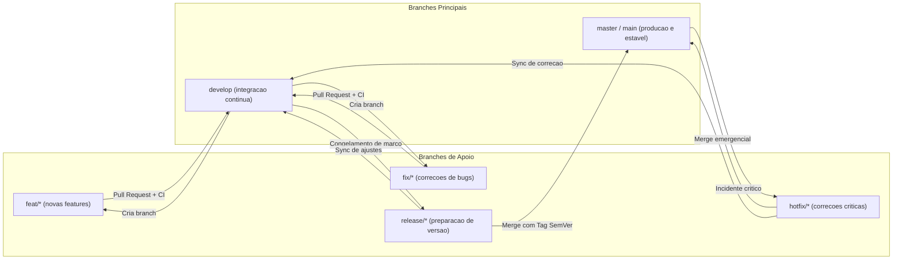
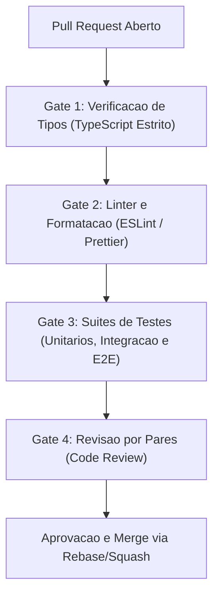

# DOMUS

Plataforma digital para organizacao e acompanhamento da rotina de corretores de imoveis, com foco em mobilidade, gestao de contatos, visitas e programacao de retornos comerciais.

---

## Sobre o Projeto

O DOMUS nasce da necessidade de superar as limitacoes de planilhas manuais na rotina de corretores autonomos. A partir de um estudo de caso com a Persona Junior (corretor atuante em Joao Pessoa - PB), identificou-se que o esquecimento de prazos e o atraso no retorno a clientes sao os principais fatores de desgaste no relacionamento comercial.

A proposta e fornecer uma ferramenta simples, direta e acessivel via dispositivo movel para centralizar o historico do cliente, os imoveis vinculados e o status de cada atendimento com avisos automaticos de compromissos proximos.

---

## Contexto Academico

- **Instituicao:** Centro Universitario UNIESP
- **Curso:** Sistemas para Internet (5o Periodo - 2026.2)
- **Unidade Curricular:** Programacao para Dispositivos Moveis e Projeto Extensionista IV (Empreendedorismo e Inovacao)
- **Professor Orientador:** Alekiss Manco de Melo
- **Equipe:**
  - Alexander Augusto de Figueiredo Baxendale
  - Pedro Neto Amancio
  - Rodrigo Santos Costa

---

## Principais Recursos

- **Gestao de Clientes:** Cadastro basico, canal principal de contato (WhatsApp, Telefone, Presencial) e vinculo com imoveis de interesse.
- **Catalogo de Imoveis:** Registro de caracteristicas fisicas (comodos, area, posicao solar) e comerciais (valores, venda e locacao).
- **Agendamento Inteligente:** Marcacao de visitas a imoveis, reunioes de atendimento e retornos obrigatorios, com validacao para evitar conflitos de horario na agenda do corretor.
- **Central de Avisos:** Alertas ativos para compromissos proximos da data marcada, retornos atrasados e pendencias sem data definida.
- **Integracao de Calendario:** Geracao de eventos compativeis com o Google Calendar.
- **Controle de Acesso:** Autenticacao segura via JWT com perfis de Corretor e Cadastrador.

### Interface do Aplicativo Mobile (Prototipo Atual)

A tela de **Cadastro de Clientes** implementada em React Native com Expo SDK 58 e integrada a API:

<p align="center">
  
</p>

---

## Arquitetura e Tecnologias

O sistema e estruturado em uma arquitetura desacoplada cliente-servidor:

- **Mobile (Frontend):** Desenvolvido em **React Native** com **Expo SDK 58** e **TypeScript**, priorizando uso em smartphones por corretores em deslocamento e suporte multiplataforma (Android, iOS e Web). Os padrões de arquitetura, ergonomia Apple HIG, física de gestos e persistência offline-first estão detalhados em [docs/MOBILE_SYSTEM_DESIGN.md](docs/MOBILE_SYSTEM_DESIGN.md).
- **Backend (API):** Desenvolvido em **Node.js 22** com **TypeScript** e **NestJS 11**, seguindo principios de arquitetura modular, injecao de dependencias e validacao estrita por DTOs.
- **Banco de Dados e Persistencia:** **Prisma ORM** com **SQLite** persistente (`dev.db`) e historico de **Migrations SQL versionadas**, permitindo execucao zero-config tanto nativa quanto via Docker.
- **Testes e Qualidade:** Cobertura de testes unitarios e ponta a ponta (E2E) com **Jest** e **Supertest**, alem de tipagem estrita com **TypeScript**.

---

## Estrutura do Repositorio

```text
DOMUS/
├── backend/          # API RESTful (NestJS, TypeScript, Prisma ORM, SQLite)
│   ├── prisma/       # Migrations SQL versionadas, schema e seed inicial
│   ├── src/          # Modulos de negocio, auth JWT, usuarios e agendamentos
│   ├── test/         # Testes unitarios, testes E2E e setup isolado
│   ├── Dockerfile    # Imagem de producao multi-stage Node 22 Alpine
│   └── README.md     # Documentacao tecnica detalhada da API
├── mobile/           # Aplicativo Movel (React Native, Expo SDK 58, TypeScript)
│   ├── src/          # Telas (Clientes), componentes, servicos e contexto
│   ├── App.tsx       # Componente raiz integrado ao contexto global
│   └── README.md     # Guia do aplicativo movel e preview web
├── docs/             # Documentacao do projeto extensionista
│   ├── MOBILE_SYSTEM_DESIGN.md        # Arquitetura e system design do modulo mobile
│   ├── guia-apresentacao-academica.md # Roteiro detalhado para apresentacao em sala
│   ├── entrevistas/  # Transcricoes e validacoes do estudo de caso
│   ├── modelos/      # Diagnostico institucional e jornada do usuario
│   ├── prototipos/   # Wireframes e especificacoes visuais das telas
│   └── superpowers/  # Especificacoes tecnicas e planos de implementacao
├── docker-compose.yml# Orquestracao do backend com volume persistente SQLite
└── README.md         # Visao geral do projeto DOMUS (este arquivo)
```

---

## Como Executar o Projeto

### 1. Execucao do Backend (API e Banco de Dados)

O backend pode ser executado de forma **nativa (sem Docker)** ou **containerizada (com Docker Compose)**. Ambas utilizam exatamente o mesmo banco SQLite persistente (`backend/prisma/dev.db`):

#### Opcao A: Execucao Direta Local (Sem Docker - Rapido e Leve)

```powershell
# 1. Entrar na pasta do backend
cd backend

# 2. Instalar dependencias
npm install

# 3. Aplicar as migrations do Prisma no banco SQLite (dev.db)
npx prisma migrate deploy

# 4. Popular dados iniciais de teste (Persona Junior)
npm run prisma:seed

# 5. Iniciar o servidor de desenvolvimento
npm run start:dev
```

#### Opcao B: Via Docker Compose (Containerizado)

```powershell
# Na raiz do projeto, suba o container em background:
docker compose up -d

# Visualizar logs em tempo real:
docker compose logs -f backend
```

- **Acesso da API:** `http://localhost:3000/api`
- **Documentacao Interativa Swagger:** `http://localhost:3000/api/docs`
- **Painel Visual do Banco (Prisma Studio):** `npm run prisma:studio` na pasta `backend` (disponivel em `http://localhost:5555`)

---

### 2. Execucao do Mobile (React Native / Expo)

Em outro terminal, execute o aplicativo movel:

```powershell
# 1. Entrar na pasta do mobile
cd mobile

# 2. Instalar dependencias (se primeira vez)
npm install

# 3. Iniciar o servidor de desenvolvimento Expo:
npm start

# (Opcional) Para abrir direto no navegador web:
npm run web
```

#### Como visualizar a aplicacao:
- **No Celular Físico (Expo Go):**
  - **Android:** Abra o app **Expo Go** e escaneie o QR Code exibido no terminal.
  - **iOS:** Abra a câmera nativa, aponte para o QR Code e toque no link do Expo Go.
- **No Navegador Web:** Pressione `w` no terminal do Expo ou acesse `http://localhost:8081`.

#### Conectando o Celular ao Backend:
- O app possui **deteccao automatica do IP da maquina** na rede local.
- **Badge Interativa no Cabecalho:** Toque na badge de status no topo da tela ("Modo Demo Local" ou "API Online") para abrir o **Modal de Conexao**. Nele voce pode:
  - Verificar a URL ativa da API;
  - Digitar um novo IP (caso use Wi-Fi ou roteador de dados moveis);
  - Testar o ping da API em tempo real;
  - Alternar entre comunicacao online com o banco e o modo demo offline.

---

## Execucao dos Testes Automatizados

O projeto conta com suítes de testes automatizados com protecao de integridade:

### Testes do Backend (Jest / Supertest)
```powershell
cd backend

# Executa testes unitarios das regras de negocio em banco isolado (test.db)
npm test

# Executa testes de ponta a ponta (E2E)
npm run test:e2e

# Checagem de tipos estrita e linter
npm run lint
npm run build
```

### Testes do Mobile (Jest / React Test Renderer)
```powershell
cd mobile

# Executa testes unitarios de componentes, telas e regras
npm test

# Verificacao estrita de tipos TypeScript
npm run typecheck
```

---

## Estrategias de Engenharia de Software e Git Flow

> [!NOTE]
> **TL;DR:** O desenvolvimento do DOMUS adota práticas consolidadas de engenharia de software: modelo Git Flow para versionamento em equipe, Conventional Commits para rastreabilidade de histórico, Quality Gates rígidos de integração contínua (CI) e pirâmide de testes automatizados com isolamento de banco.

### 1. Modelo de Ramificacao (Git Flow Adaptado)

O versionamento segue o padrão **Git Flow** adaptado para entregas incrementais por módulos e releases acadêmicas:



| Branch | Finalidade | Origem | Destino do Merge |
| :--- | :--- | :--- | :--- |
| `master` / `main` | Código estável, homologado e pronto para produção | N/A | Recebe apenas de `release/*` ou `hotfix/*` |
| `develop` | Linha principal de integração com funcionalidades em validação | `master` | Base para criação de `feat/*` e `fix/*` |
| `feat/*` | Desenvolvimento de novas funcionalidades ou telas | `develop` | Retorna para `develop` via Pull Request |
| `fix/*` | Correções de bugs identificados durante os testes | `develop` | Retorna para `develop` via Pull Request |
| `release/*` | Polimento final, ajustes de documentação e congelamento | `develop` | Mescla em `master` (com tag de versão) e em `develop` |
| `hotfix/*` | Correção urgente de problemas críticos em produção | `master` | Mescla em `master` e em `develop` |

---

### 2. Padronizacao de Commits (Conventional Commits)

Todas as mensagens de commit seguem a convenção do **Conventional Commits 1.0.0**, garantindo geração determinística de changelog e rastreabilidade:

| Prefixo | Descrição e Finalidade | Exemplo no DOMUS |
| :--- | :--- | :--- |
| `feat:` | Implementação de nova funcionalidade | `feat(backend): adicionar rota de disparo de avisos` |
| `fix:` | Correção de defeito ou bug identificado | `fix(mobile): corrigir calculo de status de agendamentos atrasados` |
| `test:` | Adição ou refatoração de testes unitários ou E2E | `test(backend): adicionar suite para validacao de choques de horario` |
| `docs:` | Atualizações em documentação, especificações ou README | `docs: atualizar diagrama de arquitetura cliente-servidor` |
| `refactor:` | Modificações internas de código sem alteração de comportamento | `refactor(mobile): desacoplar servicos de contexto de autenticacao` |
| `perf:` | Otimizações de desempenho ou redução de overhead | `perf(backend): otimizar query prisma de listagem com contagem` |
| `chore:` | Tarefas de manutenção, dependências ou scripts auxiliares | `chore(deps): atualizar pacote jest para versao 29` |

---

### 3. Esteira de Integracao e Gates de Qualidade (Quality Gates)

Para assegurar que nenhuma alteração instável alcance as branches principais, cada Pull Request deve obrigatoriamente cumprir os seguintes critérios de aceitação:



1. **Checagem Estrita de Tipos:** Execução de `tsc --noEmit` no mobile e `nest build` no backend, com tolerância zero a erros de tipagem.
2. **Qualidade de Código e Formatação:** Conformidade total com regras de ESLint e formatação Prettier em ambos os pacotes.
3. **Cobertura e Execução de Testes:** Todas as suítes (unitárias e ponta a ponta) devem passar com 100% de sucesso.
4. **Proteção de Branches:** Proibição de pushes diretos (`git push --force`) nas branches `master` e `develop`. Todo código entra exclusivamente via Pull Request revisado.

---

### 4. Estrategia de Testes e Confiabilidade (Testing Strategy)

A estratégia de testes do projeto segue a clássica **Pirâmide de Testes**, priorizando testes rápidos na base e validações integradas no topo:

- **Testes Unitários e de Componentes (Mobile):** Validação isolada de hooks, renderizadores de componentes, máscaras de documentos e temas com `Jest` e `React Test Renderer`.
- **Testes de Integração de Serviços (Backend):** Testes das regras de negócio (conflitos de agendamento, restrições cadastrais, avisos e filtros) com `Jest` conectado a banco SQLite real isolado (`test.db`).
- **Testes End-to-End / E2E (Backend):** Simulação de requisições HTTP completas via `Supertest` validando o fluxo integral do usuário (login JWT, RBAC de perfis, criação de registros e restrições de acesso).
- **Proteção contra Concorrência no Banco:** Utilização da flag `--runInBand` no Jest para execução serializada das suítes de teste de integração, prevenindo condições de corrida e conflitos de I/O no banco SQLite compartilhado.
- **Isolamento de Ambientes:** Separação estrita entre o banco de desenvolvimento local (`dev.db`) e o banco efêmero de testes (`test.db`), garantindo que execuções de testes nunca alterem os dados cadastrados em desenvolvimento.

---

### 5. Principios de Design e Arquitetura de Software

O código do DOMUS é orientado pelos seguintes princípios de engenharia:

- **Separation of Concerns (SoC):** Desacoplamento entre controladores HTTP, serviços de regra de negócio e camada de acesso a dados (Prisma ORM) no backend; separação entre UI, gerenciamento de estado (`Context API`) e serviços de comunicação (`domusApi`) no mobile.
- **Single Source of Truth (SSOT):** O schema relacional do Prisma (`schema.prisma`) é a única fonte da verdade para o modelo de dados do backend, e os contratos de tipos TypeScript unificam o frontend e o backend.
- **Fail-Fast & Fail-Closed:** Validação imediata de entradas na borda da aplicação através de DTOs tipados com `class-validator` e `ValidationPipe`. Em situações de erro ou falta de credenciais, o sistema bloqueia preventivamente o acesso em vez de executar operações degradadas.
- **Inversao de Dependencia e Modularidade:** Utilização de injeção de dependências nativa do NestJS, facilitando a substituição de serviços por mocks e garantindo facilidade de teste e manutenibilidade.

---

## Decisoes Tecnicas e Alternativas Avaliadas

### Avaliacao do PocketBase

Durante a fase de desenho do backend, foi considerada a utilizacao do **PocketBase** (BaaS em Go com SQLite embutido) visando agilidade inicial.

**Vantagens identificadas:**
- Setup instantaneo com binario unico e SQLite embutido.
- Painel de administracao e autenticacao prontos para uso.
- Suporte nativo a Server-Sent Events (SSE) para envio de alertas em tempo real.

**Motivos para adocao do NestJS:**
- **Regras de Negocio Condicionais:** O DOMUS possui restricoes como a obrigatoriedade de imovel apenas em visitas e deteccao de choques de horario de corretores, que no PocketBase exigiriam scripts adicionais em `pb_hooks`.
- **Visoes Agrupadas:** O painel exige agregacao simultanea por cliente e por imovel, necessitando de views SQL manuais no PocketBase.
- **Alinhamento Curricular:** Por se tratar de um projeto academico de Sistemas para Internet, o NestJS proporciona maior visibilidade sobre camadas de servico, tipagem estatica, injecao de dependencias e execucao formal de testes automatizados.

Dessa forma, optou-se pelo NestJS com Prisma ORM e SQLite para garantir controle pleno sobre a logica de negocio, extensibilidade futura e conformidade com as boas praticas de engenharia de software.

---

## Referencias

- Arquitetura e System Design do Modulo Mobile: [docs/MOBILE_SYSTEM_DESIGN.md](docs/MOBILE_SYSTEM_DESIGN.md)

- Diagnostico da Problematica e Plano de Intervencao: `docs/MODELO DIAGNOSTICO DA PROBLEMÁTICA E PLANO DE INTERVENÇÃO.docx`
- Especificacao Funcional do Backend: `docs/superpowers/specs/2026-10-17-domus-backend-nestjs-design.md`
- Roteiro de Apresentacao Academica: `docs/guia-apresentacao-academica.md`
- Guia Tecnico da API: `backend/README.md`
- Guia do Aplicativo Mobile: `mobile/README.md`
