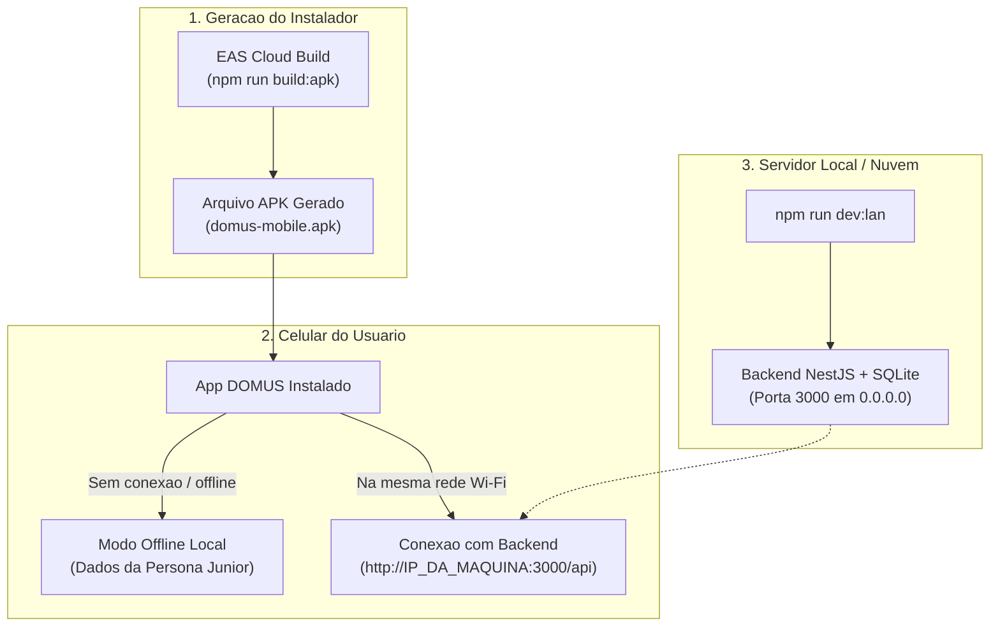

# Guia de Geracao do APK Android e Integracao com o Backend

> [!NOTE]
> **TL;DR:** O arquivo `.apk` e gerado diretamente pelo Expo EAS Cloud (`npm run build:apk`) sem exigir instalacao manual do Android Studio. O aplicativo instalado no celular Android funciona de duas maneiras complementares: 100% autonomo no Modo Offline (com dados embutidos da Persona Junior) ou conectado ao backend via Wi-Fi (`npm run dev:lan`).

---

## 1. Arquitetura de Integracao e Execucao



---

## 2. Passo a Passo para Gerar o APK no Celular

### Passo 1: Disparar a Build do APK via Expo EAS

Abra o terminal na pasta raiz do projeto DOMUS e execute:

```bash
npm run build:apk
```

*(Ou alternativamente: `cd mobile && npx eas-cli build -p android --profile preview`)*

### Passo 2: Login no Expo (apenas no primeiro uso)

Se for a primeira vez usando o EAS no seu computador:
1. O terminal perguntara se voce ja possui uma conta Expo.
2. Caso nao tenha, crie uma conta gratuita em [expo.dev](https://expo.dev/signup) ou crie diretamente no prompt.
3. Apos o login, o Expo fara o upload do codigo e compilara o APK nos servidores da nuvem.

### Passo 3: Baixar e Instalar no Celular

1. Ao finalizar a compilacao, o terminal exibira um **QR Code** e um **Link Direto** para download.
2. Aponte a camera do seu celular Android para o QR Code (ou abra o link no navegador do celular).
3. Baixe o arquivo `.apk` e toque para instalar (permita instalacao de fontes desconhecidas caso o Android solicite).

---

## 3. Como o APK Funciona com o Backend

| Modo de Uso | Como Funciona | Quando Utilizar |
| :--- | :--- | :--- |
| **Modo 1: 100% Autonomo (Offline)** | O aplicativo possui todos os dados de demonstracao da Persona Junior embutidos. Nao necessita de computador ou servidor ligado. | Apresentacoes rapidas, demonstracoes academicas, bancas e locais sem internet. |
| **Modo 2: Integrado com Backend Local** | Execute `npm run dev:lan` no computador. O app no celular se conecta via Wi-Fi ao backend NestJS e sincroniza o banco SQLite. | Demonstracao de fluxo ponta a ponta (login real, persistencia no banco e rotas de API). |

---

## 4. Conectando o Celular ao Backend Local (Wi-Fi)

Para testar a integracao com o backend em tempo real:

1. Conecte o computador e o celular na mesma rede Wi-Fi.
2. No computador, inicie o backend com o comando:
   ```bash
   npm run dev:lan
   ```
3. O terminal informara o IP da sua maquina, por exemplo: `http://192.168.1.15:3000/api`.
4. No aplicativo DOMUS no celular:
   - Toque no indicador de status no cabecalho (topo da tela).
   - Confirme ou digite o endereco informado pelo terminal.
   - O aplicativo alternara o status para `Online` e se comunicara diretamente com o backend.

---

## 5. Estrutura dos Arquivos de Configuracao Criados

- `mobile/eas.json`: Perfil `preview` configurado com `buildType: "apk"`.
- `mobile/app.json`: Pacote Android configurado como `com.domus.mobile`, versao de codigo e permissoes de rede (`INTERNET`, `ACCESS_NETWORK_STATE`).
- `backend/src/main.ts`: Escuta em todas as interfaces de rede (`0.0.0.0`) para permitir conexoes externas de celulares.
- `scripts/host-lan.js`: Utilitario automatico que detecta o IP local e inicia o backend com instrucoes visuais.
