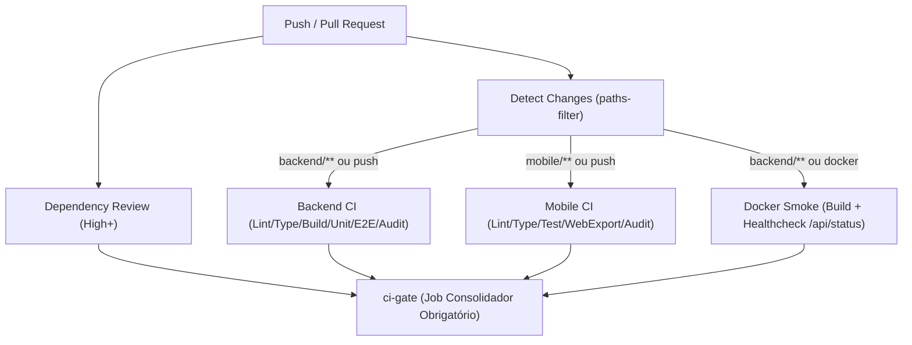

# ADR-0001: Esteira de CI/CD com Quality Gates e Comandos Unificados da Raiz

## TL;DR
Implementacao de esteira automatizada no GitHub Actions e scripts unificados na raiz do repositorio para garantir qualidade de codigo, conformidade de tipos, execucao de testes e governanca de PRs no projeto DOMUS, com job consolidador `ci-gate` e preparo idempotente de `test.db`.

---

## Status
Aceito

## Data
2026-11-04

## Contexto
O projeto DOMUS e composto por um backend NestJS 11 com Prisma ORM e SQLite, e um aplicativo movel em React Native com Expo SDK 58. Anteriormente, os comandos de desenvolvimento, lint, teste e build eram executados isoladamente dentro de cada subpasta (`backend/` e `mobile/`), sem padronizacao centralizada de validacao nem esteira automatizada de Continuous Integration (CI) no GitHub.

Principais riscos identificados:
- Ausencia de validacao automatica de Pull Requests e pushes em branches de feature.
- Risco de quebra de testes no backend decorrente de esquecimento da execucao de migrations em `test.db`.
- Falta de verificacao estrita de tipos e formatacao antes da integracao de codigo.
- Necessidade de alternar manualmente de diretorio (`cd backend` / `cd mobile`) para checar conformidade antes do envio de alteracoes.

## Decisao
Adotar uma esteira de CI/CD modular no GitHub Actions combinada com scripts orquestradores na raiz do repositorio e hooks de preparo de banco:

1. **Scripts Unificados na Raiz (`package.json`):**
   - `npm run verify`: Executa em sequencia `format:check`, `lint`, `typecheck` e `test`.
   - `npm run install:all`, `npm run format:check`, `npm run format`, `npm run lint`, `npm run typecheck`, `npm run test:backend`, `npm run test:mobile`, `npm test`.

2. **Preparo Idempotente do Banco de Testes (`backend/package.json`):**
   - Criacao do script `test:db:prepare`, vinculado aos hooks `pretest` e `pretest:e2e`. Garante geracao do Prisma Client e aplicacao de migrations em `test.db` antes da execucao de Jest.

3. **Esteira de CI com Quality Gates (`.github/workflows/ci.yml`):**
   - Deteccao seletiva de caminhos modificados via `dorny/paths-filter@v3`.
   - Dependency review com bloqueio em severidade high.
   - Jobs paralelos `backend-ci` (Node 22, lint, typecheck, build, unit tests, e2e, audit) e `mobile-ci` (Node 22, lint, typecheck, tests, export:web, audit).
   - Teste de fumaca `docker-smoke` que constroi a imagem de producao e valida o endpoint `/api/status`.
   - Job consolidador `ci-gate` com avaliacao estrita de todos os resultados anteriores, servindo como check unico requerido para regras de protecao de branch.

4. **Governanca de PRs (`.github/workflows/pr-governance.yml`):**
   - Validacao semantica de titulos de PR via Conventional Commits.
   - Rotulagem automatica por escopo de arquivo modificado via `actions/labeler@v5`.

## Alternativas Descartadas

| Abordagem | Vantagens | Desvantagens | Motivo do Descarte |
| :--- | :--- | :--- | :--- |
| Monorepo tooling complexo (Nx / Turborepo) | Cache distribuido e pipeline avancado | Overhead de configuracao e complexidade desnecessaria para o escopo do MVP academico | Descartado: scripts npm com `--prefix` atendem plenamente sem dependencias externas pesadas |
| Checks individuais como required no GitHub | Sem necessidade de job consolidador | Quebra quando paths-filter pula jobs condicionais em PRs que alteram apenas docs ou apenas um modulo | Descartado: job consolidador `ci-gate` unifica o status independente de jobs pulados |
| Migrations executadas manualmente antes do teste | Menos passos automatizados | Falha frequente por esquecimento de atualizar `test.db` | Descartado: hook `test:db:prepare` elimina erro humano |

## Consequencias e Invariantes
- [CONTRATO] `npm run verify` deve estar 100% verde localmente antes da abertura de qualquer Pull Request.
- [INVARIANTE] O status check de branch protection no GitHub deve apontar exclusivamente para `ci-gate`.
- [INVARIANTE] `test.db` nunca e commitado no git; e gerado/migrado sob demanda pelo runner ou localmente.
- O tempo de execucao de PRs e reduzido gracas ao filtro de caminhos modificados.
