# ADR-001: Remediacao de Vulnerabilidades NPM, Blindagem de Cache Prisma ORM e Pipeline CI Endurecido

## TL;DR
Saneamento quantitativo de 100% das vulnerabilidades NPM (0 alertas em root, backend e mobile) via overrides e tarball local deepmerge@4.3.2 (patch CWE-1321). Implementacao de hooks anti-cache do Prisma ORM sob npm 11 allowScripts (postinstall, prebuild, prestart:dev, preflight), novo pipeline .github/workflows/ci-security.yml com permissoes minimas e actions pinadas por SHA, e integracao de 4 skills oficiais ao /code-workflow.

---

## Status
Accepted

## Data
2026-11-08

---

## Fluxo da Solucao Integrada

```mermaid
flowchart TD
    subgraph SANEAMENTO["1. Saneamento de Dependencias (0 Vulnerabilidades)"]
        DepsScan["npm audit: 20 vulns backend / 23 vulns mobile"] --> Overrides["Overrides em package.json (minimatch, glob, js-yaml, multer, deepmerge-ts)"]
        Overrides --> Tarball["Tarball local vendor/deepmerge-4.3.2.tgz (Bloqueio CWE-1321)"]
        Tarball --> AuditZero["npm audit: 0 vulnerabilities (root, backend, mobile)"]
    end

    subgraph ORM_CACHE["2. Blindagem de Cache do Prisma ORM"]
        Npm11["npm 11+ allowScripts bloqueia terceiros"] --> Hooks["Hooks explicitos no backend/package.json: postinstall, prebuild, prestart:dev"]
        Hooks --> Preflight["Script unificado npm run preflight na raiz"]
        Preflight --> CodegenOK["Prisma Client e tipos sempre regenerados e sincronizados"]
    end

    subgraph CI_HARDENING["3. Pipeline GitHub Actions Endurecido"]
        Trigger["Push / PR / Agendamento"] --> CI["ci-security.yml (Node 22 / Ubuntu Latest)"]
        CI --> Perms["permissions: contents: read + persist-credentials: false"]
        Perms --> SHAPins["Actions pinadas por SHA de 40 caracteres"]
        SHAPins --> Gates["Execucao: npm ci, prisma generate, migrate deploy, typecheck, lint, test, npm audit"]
    end
```

---

## Contexto

O projeto DOMUS opera com arquitetura fullstack desacoplada: API REST em NestJS 11 + Prisma 6 + SQLite (`backend/`) e aplicativo mobile em Expo SDK 58 + React Native 0.88 + React 19 (`mobile/`).

Tres desafios tecnicos concorrentes demandaram intervencao arquitetural:

1. **Vulnerabilidades Transitivas no Ecossistema NPM:** Auditorias estaticas via `npm audit` acusavam 20 alertas no `backend/` (incluindo `deepmerge-ts`, `minimatch`, `glob`, `multer`, `js-yaml` e `deepmerge`) e 23 alertas no `mobile/` (incluindo `minimatch`, `glob` e `deepmerge`). O pacote `deepmerge@4.3.1` (dependencia transitiva do Jest e React Native Testing Library) apresentava vulnerabilidade de poluicao de prototipo ([CWE-1321](https://cwe.mitre.org/data/definitions/1321.html)), impedindo aprovacao quantitativa estrita (requisito de 0 vulnerabilidades).
2. **Bloqueio de Scripts no npm 11+ (`allowScripts`):** A politica de seguranca padrao do `npm 11+` desativa a execucao automatica de scripts de terceiros (`node_modules/@prisma/client/postinstall.js`). Em instalacoes limpas ou apos alteracoes de dependencias, o Prisma Client nao era regenerado deterministicamente, gerando stubs desatualizados ou quebra de tipagem (`tsc --noEmit`).
3. **Ausencia de Pipeline Endurecido e Skills Especializadas:** O repositorio carecia de workflow dedicado de seguranca no GitHub Actions para validar `npm audit`, geracao de tipos e suíte completa sob regras de menor privilegio (`permissions: contents: read`), alem de diretrizes operacionais de agentes para ferramentas Prisma e CI/CD.

---

## Decisao

1. **Saneamento Quantitativo com Overrides e Patch Local:**
   - No `backend/package.json`: aplicados `overrides` para `multer@2.5.0`, `js-yaml@^5.4.1`, `deepmerge-ts@^8.0.2`, `minimatch@^11.0.5`, `glob@^14.0.4` e `deepmerge` apontando para `$deepmerge` associado a `file:./vendor/deepmerge-4.3.2.tgz`.
   - No `mobile/package.json`: aplicados `overrides` para `minimatch@^11.0.5`, `glob@^14.0.4` e `deepmerge` apontando para `$deepmerge` associado a `file:./vendor/deepmerge-4.3.2.tgz`.
   - Criado o pacote local `vendor/deepmerge-4.3.2.tgz` (replicado em `backend/vendor/` e `mobile/vendor/`), implementando guarda ativa contra chaves `__proto__`, `constructor` e `prototype` tanto no alvo quanto na fonte na funcao `propertyIsUnsafe`.
   - **Resultado:** `0 vulnerabilities` comprovado em `root`, `backend/` e `mobile/`.

2. **Blindagem do Ciclo de Vida do Prisma ORM:**
   - No `backend/package.json`: configurados hooks declarativos de primeiro nivel `"postinstall": "prisma generate"`, `"prebuild": "prisma generate"`, `"prestart:dev": "prisma generate"` e `"typecheck": "tsc --noEmit"`. Como residem no manifesto raiz do servico, sao executados obrigatoriamente pelo npm 11+.
   - No `package.json` raiz: criado o comando `"preflight": "npm run prisma:generate --prefix backend && npm run typecheck && npm test && npm run audit"`, centralizando a validacao estrita pre-apresentacao e pre-commit.

3. **Pipeline GitHub Actions Endurecido (`.github/workflows/ci-security.yml`):**
   - Configurada diretiva de minima concessao global `permissions: contents: read`.
   - Checkout seguro com `persist-credentials: false`.
   - Actions oficiais pinadas por commit SHA imutavel de 40 caracteres (`actions/checkout@11bd71901bbe5b1630ceea73d27597364c9af683` e `actions/setup-node@49933ea5288caeca8642d1e84afbd3f7d6820020`).
   - Jobs independentes para backend e mobile executando `npm ci`, codegen, migracoes SQLite (`DATABASE_URL=file:./prisma/dev.db npx prisma migrate deploy`), compilacao, `typecheck`, `npm test`, `test:e2e` e `npm audit --audit-level=low`.

4. **Integracao de 4 Skills Oficiais ao `/code-workflow`:**
   - Instaladas globalmente e mapeadas em `SKILL.md`: `prisma-cli` e `prisma-client-api` (Clean-Install & Codegen Gate em etapas de codigo, teste e pre-flight); `github-actions` e `github-actions-hardening` (construcao e revisao de workflows CI/CD com foco em minimizacao de privilégios e prevencao de injecao de scripts).

---

## Alternativas Descartadas

| Alternativa | Prós | Contras | Motivo do Descarte |
| :--- | :--- | :--- | :--- |
| `npm audit fix --force` | Execucao automatica em comando unico. | Rebaixa o Expo SDK 58 para 53 e rebaixa React 19 para React 18. | [CRITICO] Quebra totalmente a stack mobile, gerando incompatibilidade de renderizacao e destruindo recursos de performance nativa. |
| Aceitar alertas Low de `deepmerge` sem correcao | Evita criacao de tarball local. | Mantem 8/4 alertas no relatorio e mantem codigo vulneravel a prototype pollution em tempo de teste. | Descartada por violar o criterio quantitativo de 0 vulnerabilidades e tolerar vulnerabilidade CWE-1321 conhecida. |
| Depender exclusivamente do hook interno de `@prisma/client` | Nao adiciona scripts extras no `backend/package.json`. | npm 11+ bloqueia a execucao por padrao via `allowScripts`, gerando stubs sem tipos em containers e CI. | [FALHA] Causa quebra silenciosa de tipos (`TS2345`) e falha durante build apos instalacao limpa. |
| Usar tags mutaveis nas GitHub Actions (ex.: `@v4`) | Sintaxe compacta e atualizacoes automaticas de patch. | Suscetivel a supply chain attacks caso a tag de release seja sequestrada ou alterada no upstream. | Descartada conforme diretrizes do `github-actions-hardening`; substituida por pinning SHA de 40 caracteres. |

---

## Consequencias e Invariantes

- [INVARIANTE] O comando `npm run audit` na raiz (e seus equivalentes nos modulos) deve retornar sempre `0 vulnerabilities`.
- [INVARIANTE] Qualquer adicao de dependencia transitiva vulneravel deve ser resolvida via bloco `overrides` preservando versoes principais compativeis.
- [INVARIANTE] O manifesto `backend/package.json` deve manter hooks `postinstall`, `prebuild` e `prestart:dev` chamando `prisma generate` para imunidade contra o bloqueio `allowScripts` do npm 11+.
- [INVARIANTE] Todos os workflows no GitHub Actions devem declarar `permissions: contents: read` e utilizar actions de terceiros pinadas por commit SHA imutavel com anotacao de versao legivel.
- [INVARIANTE] Antes de qualquer apresentacao ou push em branch protegida, o desenvolvedor ou agente deve validar o estado da base com `npm run preflight`.
