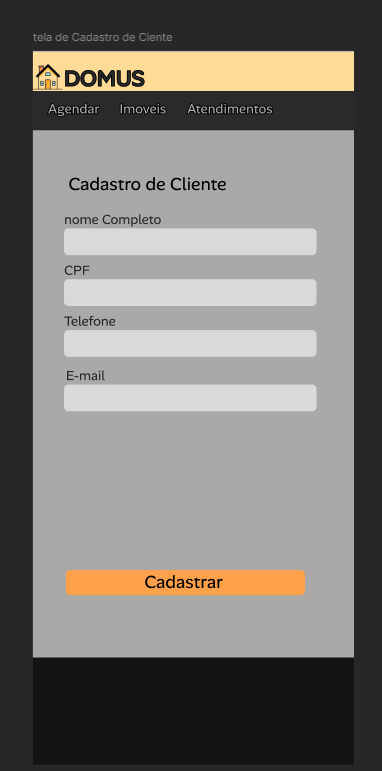
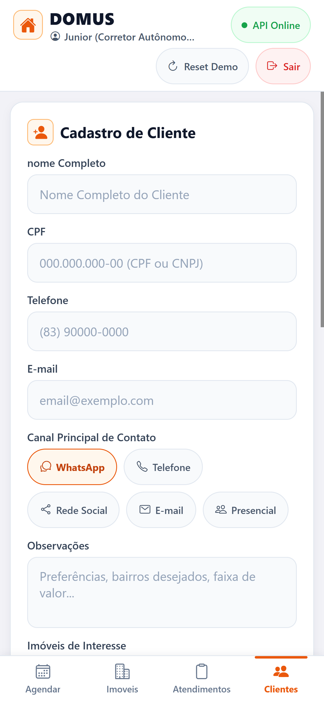

# Prototipo Mobile Expo - Tela de Cadastro de Clientes

Documentacao da interface grafica do aplicativo movel **DOMUS** em execucao no **Expo SDK 58** (React Native 0.78 / TypeScript), demonstrando a entrega da tela de **Cadastro de Clientes** validada no estudo de caso academico (UNIESP).

---

## 1. Comparativo Visual: Wireframe vs. Aplicativo Real

| Wireframe Original do Diagnostico | Prototipo Real em Execucao no Expo Go |
| :---: | :---: |
|  |  |
| *`docs/prototipos/01-cadastro-cliente.png`* | *`docs/prototipos/expo/tela-clientes-atual-expo.png`* |

---

## 2. Elementos e Regras Entregues na Interface

1. **Cabecalho Institucional (`DomusHeader`):**
   - Identidade visual com a marca `DOMUS`.
   - Badge interativa de status de rede (`Modo Demo Local` ou `API Online` com ponto verde), que abre o `ConnectionModal` para testar ping e alternar conectividade com o backend NestJS em tempo real.
   - Botoes de acao de apoio (`Reset Demo` em 2 toques inline e `Sair`).

2. **Formulario de Cadastro (`ClientesScreen`):**
   - `nome Completo`: validacao obrigatoria de preenchimento (RN04/RN05).
   - `CPF`: formatacao automatica de mascara `000.000.000-00` e validacao de tamanho/formato.
   - `Telefone`: formatacao de mascara `(00) 00000-0000`.
   - `E-mail`: campo validado para comunicacao comercial.
   - `Canal Principal de Contato`: selecao em chips táteis (`WHATSAPP`, `TELEFONE`, `REDE_SOCIAL`, `EMAIL`, `PRESENCIAL`).
   - `Observacoes`: anotacoes livres sobre perfil e preferencias do cliente.
   - `Imoveis de Interesse`: selecao tátil de imoveis vinculados para facilitar futuros agendamentos.
   - Botao `Cadastrar`: componente `DomusButton` com micro-interacoes, escala tátil e feedback inline (sem dialogs bloqueantes nativos).

3. **Listagem Virtualizada de Clientes:**
   - Implementada com `@shopify/flash-list` para maxima fluidez em dispositivos moveis (60/120 FPS).
   - Cards com dados de contato, tags de canal preferencial e atalho de acao rapida.

4. **Barra de Navegacao Inferior (`DomusNavBar`):**
   - Bottom Tab Bar no padrao Apple HIG com altura ergonomica (`minHeight: 54`) e touch targets `>= 44pt`.
   - Aba **Clientes** ativa com destaque.
   - Abas **Imoveis**, **Agendar** e **Atendimentos** mantidas como containers vazios e limpos por enquanto, prontas para as proximas iteracoes de desenvolvimento.
