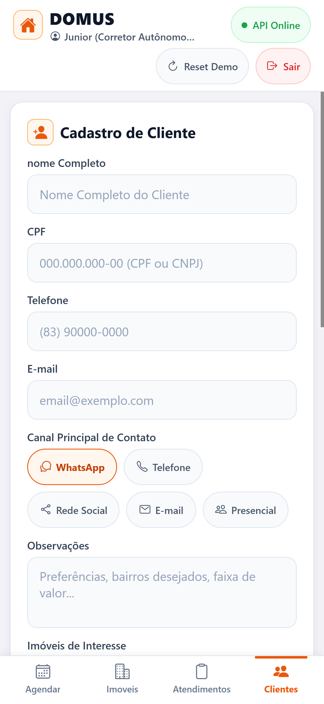

# DOMUS Mobile — Protótipo de Cadastro de Clientes (Expo Go)

Protótipo mobile do sistema **DOMUS**, desenvolvido em **React Native** com **Expo SDK 58** e **TypeScript**, entregando a tela de **Cadastro de Clientes** validada no documento acadêmico institucional [MODELO DIAGNÓSTICO DA PROBLEMÁTICA E PLANO DE INTERVENÇÃO.docx](../docs/MODELO%20DIAGN%C3%93STICO%20DA%20PROBLEM%C3%81TICA%20E%20PLANO%20DE%20INTERVEN%C3%87%C3%83O.docx) e fiel ao wireframe [01-cadastro-cliente.png](../docs/prototipos/01-cadastro-cliente.png).

---

## 1. Tela Entregue: Cadastro de Cliente

<p align="center">
  
</p>

Conforme o direcionamento da primeira entrega na **Seção 4.1 do Diagnóstico**, a aplicação apresenta:
- **Cabeçalho Institucional (`DomusHeader`):** Linha única compacta com logotipo oficial, marca `DOMUS`, identificação do corretor autenticado e botão `Sair`.
- **Barra de Navegação (`DomusNavBar`):** Barra grafite (`#262626`) com as abas e destaque ativo laranja (`#FFA347`) em "Clientes".
- **Formulário Fiel ao Wireframe (`01-cadastro-cliente.png`):**
  - `nome Completo`
  - `CPF` (com formatação automática)
  - `Telefone` (com máscara de telefone)
  - `E-mail`
  - Seleção tátil do `Canal Principal de Contato` (`WHATSAPP`, `TELEFONE`, `REDE_SOCIAL`, `EMAIL`, `PRESENCIAL`)
  - Campo `Observações` sobre interesses e perfil do cliente
  - Seleção de `Imóveis de Interesse` vinculados
  - Botão laranja padronizado `Cadastrar`
- **Listagem de Clientes Cadastrados:** Exibição dos clientes já salvos com busca rápida por texto e canal preferencial.

---

## 2. Como Executar no Celular com Expo Go

1. **Instalar dependências (caso necessário):**
   ```bash
   cd mobile
   npm install
   ```

2. **Iniciar o servidor Expo:**
   ```bash
   # Para executar no celular (Expo Go):
   npm start
   # ou
   npx expo start

   # Para visualizar no navegador web:
   npm run web
   # ou
   npx expo start --web
   ```

3. **Abrir a aplicação:**
   - No **Navegador Web:** Pressione `w` no terminal ou acesse diretamente `http://localhost:8081`.
   - No **Android:** Abra o aplicativo **Expo Go** e escaneie o QR Code exibido no terminal.
   - No **iOS:** Abra a câmera nativa do iPhone, aponte para o QR Code e toque no link do Expo Go.

---

## 3. Testes Automatizados e Verificação de Tipos

```bash
# Executar suíte de testes unitários (Jest)
npm test --prefix mobile

# Executar checagem estrita de tipos TypeScript
npm run typecheck --prefix mobile
```

---

## 4. Conexao com o Backend e Banco de Dados Real (Sem Mockup)

O aplicativo opera exclusivamente conectado a API RESTful e ao banco SQLite (o antigo modo demonstrativo offline encontra-se preservado na branch `feat/modo-demo-local`):
- **Autenticacao JWT Real (`LoginScreen`):** Exige login com usuario/e-mail e senha validados via `POST /api/auth/login` (com opcao de cadastro de conta `CORRETOR` em `POST /api/usuarios`) antes de liberar o acesso as 4 abas.
- **Deteccao Automatica de Host e Ambiente:** Quando executado no smartphone via Expo Go, o app detecta o IP do seu computador na rede local automaticamente via `expo-constants` (ou utiliza a variavel `EXPO_PUBLIC_API_URL` configurada em `mobile/.env`).
- **Cabecalho Institucional Unificado (`DomusHeader`):** Exibe em linha unica a marca `DOMUS`, o nome do usuario autenticado e o botao `Sair`.
- **Projecao em Sala de Aula:** Consulte o roteiro detalhado em [guia-apresentacao-academica.md](../docs/guia-apresentacao-academica.md) para demonstrar o salvamento em tempo real no banco projetado no telao.

