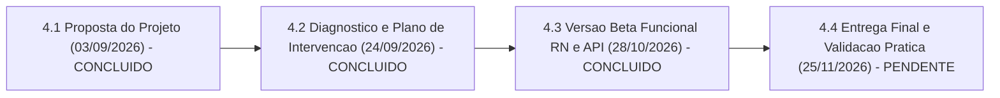

# DOMUS — Backlog Geral e Plano de Entregas (PDM e PE 2026.2)

> [!NOTE]
> **TL;DR:** Backlog mestre do projeto DOMUS baseado em [PROJETO DAS DICIPLINAS - PDM E PE.md](./docs/classroom/PROJETO%20DAS%20DICIPLINAS%20-%20PDM%20E%20PE.md) e no estado atual do codigo.
> As entregas **4.1 (Proposta)**, **4.2 (Diagnostico e Plano de Intervencao)** e **4.3 (Versao Beta Funcional — Requisitos 3.2)** estao `[CONCLUIDO]`.
> O aplicativo ja possui 4 telas completas em React Native/Expo integradas a API propria NestJS/Prisma/SQLite.
> O foco agora e a **4a Entrega — Entrega Final (Item 4.4, prazo 25/11/2026)**: validacao pratica com o corretor participante, medicao de impacto, capturas finais e defesa da equipe.

---

## Fluxo das Entregas Obrigatorias

---

## Visao Geral das Entregas (Item 4 do Plano das Disciplinas)

| Item | Entrega Obrigatoria | Prazo | Status | Evidencias no Repositorio |
| :--- | :--- | :--- | :--- | :--- |
| **4.1** | 1a Entrega — Proposta do Projeto | 03/09/2026 | `[CONCLUIDO]` | [Proposta de Projeto](./docs/modelos/MODELO%20PROPOSTA%20DE%20PROJETO%20-%20PDM%20E%20PE.md) e [Wireframes](./docs/prototipos/01-cadastro-cliente.png) |
| **4.2** | 2a Entrega — Diagnostico e Plano de Intervencao | 24/09/2026 | `[CONCLUIDO]` | [Diagnostico e Plano](./docs/DIAGN%C3%93STICO%20DA%20PROBLEM%C3%81TICA%20E%20PLANO%20DE%20INTERVEN%C3%87%C3%83O.md) e [Entrevista](./docs/entrevistas/entrevista-realizada.md) |
| **4.3** | 3a Entrega — Versao Beta Funcional (Itens 3.2) | 28/10/2026 | `[CONCLUIDO]` | Modulos `mobile/` e `backend/`, [System Design](./docs/MOBILE_SYSTEM_DESIGN.md) |
| **4.4** | 4a Entrega — Entrega Final e Apresentacao | 25/11/2026 | `[PENDENTE]` | Epicos 1 a 5 descritos na Secao 2 deste backlog |

---

## 1. O Que Ja Foi Feito (`[CONCLUIDO]`)

### 1.1. 1a Entrega — Proposta do Projeto (Item 4.1 — 03/09/2026)

- [x] **4.1.1 Descricao do problema:** Definicao inicial da dor comercial do corretor em [MODELO PROPOSTA DE PROJETO - PDM E PE.md](./docs/modelos/MODELO%20PROPOSTA%20DE%20PROJETO%20-%20PDM%20E%20PE.md).
- [x] **4.1.2 Publico-alvo:** Corretores de imoveis que buscam organizacao pratica da rotina de atendimentos.
- [x] **4.1.3 Proposta da solucao:** Aplicativo movel multiplataforma conectado a backend proprio para gestao de clientes, imoveis e compromissos.
- [x] **4.1.4 Funcionalidades previstas:** Escopo inicial levantado e posteriormente refinado apos o diagnostico de campo (Secao 5 do Diagnostico).
- [x] **4.1.5 Prototipo ou esboco das telas:** Wireframes iniciais registrados em [01-cadastro-cliente.png](./docs/prototipos/01-cadastro-cliente.png), [02-agendar-compromisso.png](./docs/prototipos/02-agendar-compromisso.png), [03-visualizacao-atendimentos.png](./docs/prototipos/03-visualizacao-atendimentos.png) e [04-aviso-agendamentos-proximos.png](./docs/prototipos/04-aviso-agendamentos-proximos.png).
- [x] **4.1.6 Cronograma:** Etapas planejadas e aprovadas para execucao do projeto extensionista.

### 1.2. 2a Entrega — Diagnostico da Problematica e Plano de Intervencao (Item 4.2 e Item 3.1 Parcial — 24/09/2026)

- [x] **Coleta de campo com comunidade/participante:** Estudo de caso unico com corretor autonomo de Joao Pessoa/PB (pseudonimo **Junior**), registrado em [entrevista-realizada.md](./docs/entrevistas/entrevista-realizada.md).
- [x] **Evidencia formal de contato:** Registro anonimizado anexado em [anexo-conversa-whatsapp.jpg](./docs/entrevistas/anexo-conversa-whatsapp.jpg) e roteiros de apoio em [roteiro-estudo-caso-domus.md](./docs/entrevistas/roteiro-estudo-caso-domus.md) e [domus-jornada-corretor.md](./docs/modelos/domus-jornada-corretor.md).
- [x] **4.2.1 Diagnostico Detalhado da Problematica:** Dor central comprovada no acompanhamento de retornos e ausencia de avisos ativos na planilha manual.
- [x] **4.2.2 Analise do Publico-Alvo:** Persona Junior detalhada com habitos, dificuldades e familiaridade tecnologica.
- [x] **4.2.3 Plano de Intervencao:** Aplicacao da solucao, estrategia em etapas, protocolo de validacao e tabela de 4 indicadores de medicao de impacto.
- [x] **4.2.4 Ajustes na Proposta Inicial:** Priorizacao de clientes, imoveis, agendamentos (visitas e retornos), visualizacao de atendimentos e central de avisos, removendo controle de comissoes do MVP em [DIAGNOSTICO DA PROBLEMATICA E PLANO DE INTERVENCAO.md](./docs/DIAGN%C3%93STICO%20DA%20PROBLEM%C3%81TICA%20E%20PLANO%20DE%20INTERVEN%C3%87%C3%83O.md) ([versao DOCX](./docs/DIAGN%C3%93STICO%20DA%20PROBLEM%C3%81TICA%20E%20PLANO%20DE%20INTERVEN%C3%87%C3%83O.docx)).

### 1.3. 3a Entrega — Versao Beta Funcional e Evolucoes Pos-Beta (Item 4.3 e Requisitos 3.2 — 28/10/2026)

Todos os requisitos tecnicos obrigatorios do item **3.2 (React Native)** estao implementados e integrados na branch principal, conforme tabela de rastreabilidade abaixo.

| Requisito (Item 3.2) | Exigencia da Disciplina | Situacao | Implementacao Verificada no Repositorio |
| :--- | :--- | :--- | :--- |
| **3.2.1 Multiplas telas** | Navegacao com ao menos 4 telas | `[CONCLUIDO]` | 5 telas integradas em [App.tsx](./mobile/App.tsx) via [DomusNavBar.tsx](./mobile/src/components/DomusNavBar.tsx): [LoginScreen.tsx](./mobile/src/screens/LoginScreen.tsx), [ClientesScreen.tsx](./mobile/src/screens/ClientesScreen.tsx), [ImoveisScreen.tsx](./mobile/src/screens/ImoveisScreen.tsx), [AgendarScreen.tsx](./mobile/src/screens/AgendarScreen.tsx) e [AtendimentosScreen.tsx](./mobile/src/screens/AtendimentosScreen.tsx) |
| **3.2.2 Componentes basicos** | `View`, `Text`, `Image`, `ScrollView`, `Pressable` | `[CONCLUIDO]` | Primitivos nativos aplicados nas telas; `Image` com [logo.png](./mobile/assets/logo.png) em [DomusHeader.tsx](./mobile/src/components/DomusHeader.tsx); migracao integral para `Pressable` com touch targets >= 44pt |
| **3.2.3 Componentizacao** | Separacao de responsabilidades e reuso | `[CONCLUIDO]` | 9 componentes reutilizaveis: [AvisoBanner.tsx](./mobile/src/components/AvisoBanner.tsx), [DomusButton.tsx](./mobile/src/components/DomusButton.tsx), [DomusDateTimePresets.tsx](./mobile/src/components/DomusDateTimePresets.tsx), [DomusHeader.tsx](./mobile/src/components/DomusHeader.tsx), [DomusInput.tsx](./mobile/src/components/DomusInput.tsx), [DomusNavBar.tsx](./mobile/src/components/DomusNavBar.tsx), [DomusToast.tsx](./mobile/src/components/DomusToast.tsx), [DomusWebPickerModal.tsx](./mobile/src/components/DomusWebPickerModal.tsx) e [InlineConfirmButton.tsx](./mobile/src/components/InlineConfirmButton.tsx) |
| **3.2.4 Uso de Props** | Comunicacao entre componentes | `[CONCLUIDO]` | Contratos tipados em [domus.ts](./mobile/src/types/domus.ts) e props entre [App.tsx](./mobile/App.tsx), telas e componentes (`onAgendarCliente`, `onAgendarImovel`, `clientePreSelecionadoId`, `imovelPreSelecionadoId`, `onNovoAgendamento`) |
| **3.2.5 Layout moderno** | Boa organizacao visual e estruturada | `[CONCLUIDO]` | Design System Apple HIG em [tokens.ts](./mobile/src/theme/tokens.ts), listas virtualizadas `@shopify/flash-list`, worklets Reanimated v4, seletores de data/hora multiplataforma e documentacao em [MOBILE_SYSTEM_DESIGN.md](./docs/MOBILE_SYSTEM_DESIGN.md) |
| **3.2.6 Dados dinamicos e API propria** | Estado local e consumo de API propria | `[CONCLUIDO]` | Estado global em [DomusContext.tsx](./mobile/src/context/DomusContext.tsx) com persistencia de JWT em [storage.ts](./mobile/src/services/storage.ts) e cliente REST [domusApi.ts](./mobile/src/services/domusApi.ts) conectado a API propria NestJS 11 ([main.ts](./backend/src/main.ts), [schema.prisma](./backend/prisma/schema.prisma), [seed.ts](./backend/prisma/seed.ts)) |
| **3.2.7 Loading e erro** | Tratamentos de loading e erro | `[CONCLUIDO]` | [DomusButton.tsx](./mobile/src/components/DomusButton.tsx) (`idle`, `loading`, `success`), guardas `useRef` contra duplo envio, toasts nao-bloqueantes em [DomusToast.tsx](./mobile/src/components/DomusToast.tsx), confirmacao inline, erros inline de validacao/autenticacao e banner de reconexao |

#### Infraestrutura Tecnica Adicional Ja Entregue

- [x] **Backend completo com regras de negocio:** Modulos de autenticacao JWT (`CORRETOR` e `CADASTRADOR`), usuarios, clientes, imoveis, agendamentos (visitas, retornos, conflitos de horario, Google Calendar) e disparo de avisos documentados em [backend/README.md](./backend/README.md).
- [x] **Testes automatizados e Quality Gates:** Suites unitarias e de integracao no mobile (`mobile/src/__tests__/`) e no backend (unitarios + E2E em [app.e2e-spec.ts](./backend/test/app.e2e-spec.ts)), alem de workflows em [ci.yml](./.github/workflows/ci.yml) e [ci-security.yml](./.github/workflows/ci-security.yml).
- [x] **Seguranca e blindagem ORM:** Auditoria de dependencias e hooks Prisma documentados em [SECURITY.md](./SECURITY.md) e [ADR-001](./docs/decisions/0001-remediacao-vulnerabilidades-npm-blindagem-prisma-ci-hardening.md), mais revisao diferencial em [DOMUS_DIFFERENTIAL_REVIEW_2026-11-08.md](./docs/DOMUS_DIFFERENTIAL_REVIEW_2026-11-08.md).
- [x] **Empacotamento Android APK e execucao em rede local (LAN):** Perfil EAS configurado em [eas.json](./mobile/eas.json), manifesto em [app.json](./mobile/app.json), detector de IP LAN em [host-lan.js](./scripts/host-lan.js), containerizacao em [docker-compose.yml](./docker-compose.yml) e manual em [GUIA_BUILD_APK_E_BACKEND.md](./docs/GUIA_BUILD_APK_E_BACKEND.md).

---

## 2. O Que Esta Pendente (`[PENDENTE]` — Backlog para a 4a Entrega Final, Item 4.4)

> [!IMPORTANT]
> **Prazo da 4a Entrega (Entrega Final):** **25/11/2026**. Como a versao Beta (`4.3`) ja atendeu integralmente os requisitos tecnicos de software (`3.2`), todo o backlog restante concentra-se em **validacao real com o publico**, **medicao de impacto**, **evidencias visuais**, **relatorio final** e **apresentacao**.

### Epico 1 `[ALTA]` — Validacao Pratica e Teste de Usabilidade com o Publico-Alvo

*Requisitos cobertos: Itens `3.1.3`, `3.1.4`, `4.4.3`, `4.4.5` e Criterios `5.2`, `5.5`.*

- [ ] **T1.1 — Aplicar sessao de teste guiado com o participante (Persona Junior):** Colocar o aplicativo real (APK Android, Expo Go ou Expo Web conectado via LAN/offline) em uso pelo corretor participante executando as 4 tarefas da Secao 4.3 do Diagnostico:
  1. Cadastrar um cliente e vincular um ou mais imoveis de interesse;
  2. Agendar uma visita vinculando cliente e imovel;
  3. Programar um retorno associado ao atendimento ou visita;
  4. Consultar compromissos e alertas no painel `Atendimentos` (`AvisoBanner`) e testar o atalho para Google Calendar.
- [ ] **T1.2 — Medir e registrar os 4 Indicadores de Impacto (Secao 4.4 do Diagnostico):** Coletar e tabular os dados observados durante a sessao pratica:
  - *Conclusao das tarefas:* o participante conseguiu concluir os fluxos sem auxilio?
  - *Visualizacao de compromissos:* clareza das visoes agrupadas por cliente, por imovel e sem data;
  - *Percepcao de melhoria:* comparacao direta de praticidade e confianca contra a planilha manual;
  - *Auxilio de novas ferramentas:* avaliacao pratica dos avisos de proximos agendamentos e do botao Google Calendar.
- [ ] **T1.3 — Registrar evidencias formais da validacao pos-MVP:** Salvar transcricao/relato da observacao, feedback do corretor e capturas ou fotos anonimizadas da sessao em `./docs/entrevistas/` (ex.: `validacao-mvp-participante.md`).
- [ ] **T1.4 `[MEDIA]` (Complementar) — Ampliar triangulacao com formulario de corretores:** Se houver disponibilidade antes de 25/11, aplicar [domus-formulario-corretores.md](./docs/entrevistas/domus-formulario-corretores.md) com outros corretores para fortalecer a secao de impacto social.

### Epico 2 `[ALTA]` — Atualizacao das Evidencias Visuais do Aplicativo no Repositorio

*Requisitos cobertos: Itens `3.1.3.5`, `4.4.5` e Criterio `5.4`.*

- [ ] **T2.1 — Capturar screenshots reais das 4 telas finais do app:** Atualmente [docs/prototipos/expo/](./docs/prototipos/expo/README.md) contem apenas [tela-clientes-atual-expo.png](./docs/prototipos/expo/tela-clientes-atual-expo.png). Adicionar os prints atuais de:
  - `ImoveisScreen` (cadastro e catalogo com proprietario e busca);
  - `AgendarScreen` (seletores de tipo, data/hora e toggle Google Calendar);
  - `AtendimentosScreen` (`AvisoBanner`, metricas, filtros e modal de retorno/conclusao).
- [ ] **T2.2 — Atualizar [docs/prototipos/expo/README.md](./docs/prototipos/expo/README.md):** Remover a nota obsoleta que informa que `Imoveis`, `Agendar` e `Atendimentos` sao containers vazios e documentar o comparativo completo dos 4 wireframes (`01` a `04`) com as telas reais entregues.

### Epico 3 `[ALTA]` — Consolidacao do Documento / Relatorio da 4a Entrega Final

*Requisitos cobertos: Itens `4.4.1` a `4.4.6` e Criterios `5.1`, `5.3`, `5.6`.*

- [ ] **T3.1 — Redigir documento consolidado da 4a Entrega Final (`docs/ENTREGA_FINAL_PDM_PE.md` e versao `.docx`):** Cobrir obrigatoriamente os 6 topicos exigidos no item `4.4`:
  1. **Demonstracao do aplicativo funcionando:** Fluxo ponta a ponta das 4 telas, funcionamento online (API NestJS + SQLite) e offline-first;
  2. **Explicacao do problema:** Sintese do estudo de caso com a Persona Junior (planilha passiva e esquecimento de retornos);
  3. **Como foi validado:** Entrevista diagnostica inicial + sessao pratica guiada do MVP com o corretor participante;
  4. **Como a solucao resolve a problematica:** Mapeamento direto de cada dor identificada para a funcionalidade implementada (retornos, `AvisoBanner`, visao por cliente/imovel e Google Calendar);
  5. **Evidencias de aplicacao/teste:** Prints reais das 4 telas, relato/registro da validacao pratica e tabela preenchida dos 4 indicadores de impacto;
  6. **Reflexao final do grupo:** Aprendizados tecnicos (React Native, Expo, NestJS, Prisma, testes e CI), dinamica da equipe (Alexander, Pedro Neto e Rodrigo), impacto social alcancado, limitacoes do estudo de caso unico e trabalhos futuros.

### Epico 4 `[ALTA]` — Preparacao da Demonstracao ao Vivo e Apresentacao Final (25/11/2026)

*Requisitos cobertos: Itens `4.4.1`, `5.4`, `5.6`.*

- [ ] **T4.1 — Revisar ou substituir `docs/guia-apresentacao-academica.md`:** Verificar a remocao local pendente na arvore Git de `docs/guia-apresentacao-academica.md`, restaurar ou atualizar o roteiro para a Entrega Final (`25/11/2026`) e alinhar os links em [README.md](./README.md) e [mobile/README.md](./mobile/README.md).
- [ ] **T4.2 — Produzir slides e roteiro de defesa da equipe:** Estruturar a apresentacao cobrindo os 6 criterios de avaliacao (Secao 5) e distribuir o tempo de fala entre os 3 integrantes do grupo.
- [ ] **T4.3 — Executar checklist tecnico pre-banca e gerar APK atualizado:**
  - Rodar `npm run preflight` na raiz para validar geracao Prisma, `tsc --noEmit`, suites de testes e `npm audit` (0 vulnerabilidades);
  - Inicializar banco limpo com `npx prisma migrate deploy` e `npm run prisma:seed` dentro de `backend/`;
  - Gerar/atualizar o APK Android via `npm run build:apk` ([GUIA_BUILD_APK_E_BACKEND.md](./docs/GUIA_BUILD_APK_E_BACKEND.md));
  - Testar conexao em rede local (`npm run dev:lan`) com o smartphone fisico e validar o fallback automatico em Modo Offline caso a rede da banca bloqueie portas locais.

### Epico 5 `[MEDIA]` — Refinamentos de Usabilidade e Validacoes de Interface (Feedback da Validacao)

*Requisitos cobertos: Criterios `5.2` (Validacao com a Comunidade), `5.4` (Qualidade Tecnica) e `5.5` (Impacto Gerado).*

#### Tela de Imoveis

- [ ] **T5.1 — Icones nos campos do proprietario:** Adicionar icone ao lado dos campos de `CPF` e `Telefone` na secao de selecao de proprietario, para facilitar o entendimento.
- [ ] **T5.2 — Validacao no cadastro de imovel:** Tornar obrigatorios os campos `inscricao`, `bairro` e `numero` para concluir o cadastro.
- [ ] **T5.3 — ScrollView na busca de Imoveis Cadastrados:** Adicionar `ScrollView` na lista de pesquisa da aba de Imoveis Cadastrados.
- [ ] **T5.4 — ScrollView na selecao de proprietario:** Adicionar `ScrollView` na lista de selecao do proprietario.
- [ ] **T5.5 — Alerta de numero duplicado:** No campo `Numero`, exibir alerta quando o usuario informar numero de imovel ja cadastrado: "Ja existe um imovel cadastrado com este endereco exato. Deseja continuar mesmo assim?".

#### Tela de Clientes

- [ ] **T5.6 — Icones nos campos de Imoveis de Interesse:** Adicionar icone ao lado dos campos de `inscricao do imovel` e `valor do imovel` na selecao de Imoveis de Interesse.
- [ ] **T5.7 — ScrollView na selecao de Imoveis de Interesse:** Adicionar `ScrollView` na lista de selecao de Imoveis de Interesse.
- [ ] **T5.8 — ScrollView na busca de Clientes Cadastrados:** Adicionar `ScrollView` na lista de busca de Clientes Cadastrados.

#### Tela de Atendimentos

- [ ] **T5.9 — ScrollView na busca de Atendimentos Cadastrados:** Adicionar `ScrollView` na lista de busca de Atendimentos Cadastrados.

#### Tela de Agendar

- [ ] **T5.10 — Remover referencias RN dos rotulos:** Remover os codigos dos textos: `Cliente (RN10)`, `Imovel obrigatorio (RN08)`, `Cliente e obrigatorio para criar o agendamento (RN10)`, `Sincronizar com Google Calendar (RN16)`, `Imovel (RN08)`, `Para agendar uma visita (tipo VISITA), é obrigatório selecionar um imóvel cadastrado (RN08)` e `Para agendar uma visita (tipo VISITA), é obrigatório informar a data e hora do compromisso (RN08)`. *Nota: `mobile/src/__tests__/agendarScreen.spec.tsx` tambem valida essas strings literalmente e precisara ser atualizado na execucao da tarefa.*
- [ ] **T5.11 — Atualizar titulo do atendimento automaticamente:** Corrigir para que o titulo (preenchido quando `tipo de compromisso` + `cliente`/`imovel` sao selecionados) seja recalculado ao trocar cliente ou imovel, sem exigir nova selecao do tipo de compromisso.

---

## 3. Matriz de Conformidade com Criterios de Avaliacao e Prevensao de Recusa

### 3.1. Criterios de Avaliacao (Item 5 do Plano das Disciplinas)

| Criterio | Pergunta-Chave da Avaliacao | Status Atual | Onde Esta Atendido / Tarefa Pendente |
| :--- | :--- | :--- | :--- |
| **5.1 Clareza do Problema** | Problema real, bem descrito e relevante? | `[OK]` | [Diagnostico Secao 1](./docs/DIAGN%C3%93STICO%20DA%20PROBLEM%C3%81TICA%20E%20PLANO%20DE%20INTERVEN%C3%87%C3%83O.md) + [Entrevista](./docs/entrevistas/entrevista-realizada.md) |
| **5.2 Validacao com a Comunidade** | Dialogo real, evidencias e solucao baseada na coleta? | `[PARCIAL]` | Diagnostico inicial `[OK]`; falta validacao pos-MVP (`T1.1`, `T1.3`) |
| **5.3 Coerencia da Solucao** | Solucao resolve o problema com logica clara? | `[OK]` | Secao 5 do Diagnostico + fluxos de retornos e `AvisoBanner` no app |
| **5.4 Qualidade Tecnica** | Estrutura, navegacao, componentes, props, organizacao e UI? | `[OK]` | 4 telas RN, 10 componentes, props tipadas, API NestJS e testes; refinamentos de UI (`T5.1`–`T5.11`); falta atualizar prints (`T2.1`, `T2.2`) |
| **5.5 Impacto Gerado** | Aplicacao pratica, teste pelo publico e medicao de resultado? | `[PENDENTE]` | Executar sessao pratica e medir os 4 indicadores (`T1.1`, `T1.2`); usabilidade refinada a partir do feedback (`T5.1`–`T5.11`) |
| **5.6 Apresentacao e Organizacao** | Clareza, dominio do projeto e organizacao documental? | `[PENDENTE]` | Consolidar relatorio final, slides e ensaio tecnico (`T3.1`, `T4.1`–`T4.3`) |

### 3.2. Prevencao de Motivos de Nao Aceitacao (Item 6 do Plano das Disciplinas)

| Risco de Recusa (Item 6) | Situacao no DOMUS | Acao de Garantia |
| :--- | :--- | :--- |
| **6.1 Falta de validacao real** | `[MITIGADO PARCIALMENTE]` | Ja existe entrevista e evidencia WhatsApp; concluir `T1.1` e `T1.3` com registro pratico do MVP |
| **6.2 App generico sem impacto social** | `[MITIGADO]` | Funcionalidades recortadas diretamente da dor do corretor autonomo (retornos e avisos ativos) |
| **6.3 Uso inadequado de React Native** | `[MITIGADO]` | Cumpre todos os 7 subitens tecnicos de `3.2` com componentes nativos, props e API propria |
| **6.4 Copia de outro projeto** | `[MITIGADO]` | Evolucao autoral da propria equipe sobre prototipo academico anterior (citado no Diagnostico e README) |
| **6.5 Uso indevido de IA** | `[ATENCAO NA BANCA]` | Garantir dominio completo dos fluxos, regras RN01–RN16 e arquitetura pelos 3 integrantes (`T4.2`) |
| **6.6 Desalinhamento extensionista** | `[MITIGADO]` | Manter foco na devolucao da ferramenta testada ao corretor e registro de impacto (`T1.2`, `T3.1`) |
